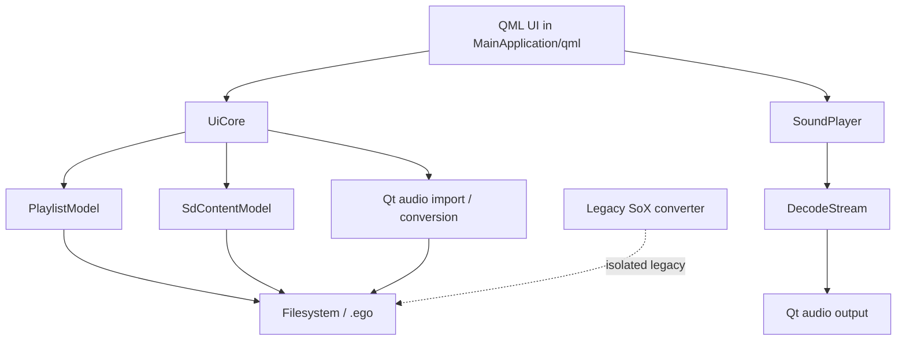

# EgoApp Architecture

*Working overview; verify against the current implementation.*

This is a conceptual diagram, not a complete call graph.

## Source layout
- `MainApplication/qml/`: QML presentation files compiled into the `EgoApp` module.
- `MainApplication/`: C++ entry point, bridge objects, models, and audio implementation. C++ remains here temporarily until focused module boundaries are defined.
- `MainApplication/icons/`, `translations/`, and `docs/`: runtime resources; their resource paths remain unchanged.

## QML module and runtime loading
CMake registers QML sources from `MainApplication/qml/` and assigns each source its basename through `QT_RESOURCE_ALIAS`. This preserves public QML type names and the `AppGlobals` singleton. Runtime loading remains `QQmlApplicationEngine::loadFromModule("EgoApp", "Main")`; the application does not load QML from a source-tree filesystem path.

## Responsibility areas
- QML: presentation and lightweight coordination.
- UiCore: QML/C++ bridge; should not absorb all business logic.
- PlaylistModel: playlist state and Qt Model/View contracts.
- SdContentModel: selected media/folder contents.
- SoundPlayer/DecodeStream: playback, decoding, and resource ownership.
- Qt audio conversion: primary audio-preparation path.
- SoX: isolated legacy component, not the primary audio path; do not modify third-party internals.

## Invariants
1. Failed operations must not destroy user source data.
2. Do not truncate the old file before the replacement is ready.
3. Propagate errors; do not report partial success as full success.
4. Keep model data and signals consistent.
5. Keep complex file operations out of QML.
6. Make async-object and temporary-file lifetimes explicit.

## File operations
Prefer a temporary file in the destination directory, validate it, then safely replace the old file. Use `QSaveFile` where its semantics fit. Handle SD removal, access errors, low disk space, partial writes, and rename failures. Preserve the previous destination until imported output is validated.

## Errors and tests
Define running/success/failure/cancelled states, partial-success behavior, cleanup, model updates, and actionable diagnostics. Test filesystem failures, index boundaries, repeated playback, and cancellation.

## Open questions
UiCore/model responsibility boundaries; synchronous versus asynchronous operations; stable `.ego` serialization contract; existing test and CI coverage.
