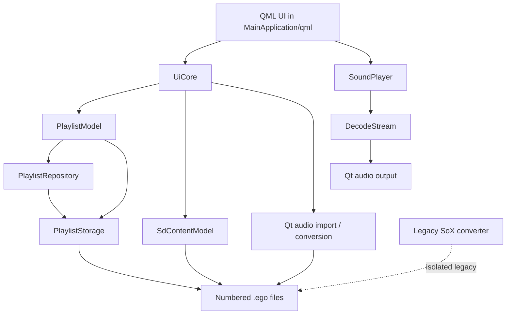

# EgoApp Architecture

*Working overview; verify against the current implementation.*

This is a conceptual diagram, not a complete call graph.

## Source layout
- `MainApplication/qml/`: QML presentation files compiled into the `EgoApp` module.
- `MainApplication/`: C++ entry point, bridge objects, media model, and audio implementation.
- `MainApplication/playlists/`: playlist feature module (`PlaylistModel`, `PlaylistRepository`, `PlaylistStorage`, and `Song`). QML-facing type names and the `.ego` file format remain unchanged.
- `MainApplication/icons/`, `translations/`, and `docs/`: runtime resources; their resource paths remain unchanged.

## QML module and runtime loading
CMake registers QML sources from `MainApplication/qml/` and assigns each source its basename through `QT_RESOURCE_ALIAS`. This preserves public QML type names and the `AppGlobals` singleton. The `MainApplication/playlists/` directory is also added to the application target's private include paths because Qt's generated QML type-registration source includes registered C++ headers by basename. Runtime loading remains `QQmlApplicationEngine::loadFromModule("EgoApp", "Main")`; the application does not load QML from a source-tree filesystem path.

## Responsibility areas
- QML: presentation and lightweight coordination.
- UiCore: QML-facing application facade; owns UI state and translates application results into Qt signals.
- PlaylistRepository: discovers playlist directories and creates/removes them safely. It returns plain `PlaylistData` records and has no QML or Qt item-model dependency.
- PlaylistStorage: reads and writes numbered `.ego` files and preserves their existing two-line format (including the optional `>` marker).
- PlaylistModel: playlist state, persistence coordination, and Qt Model/View contracts; it does not implement file-format parsing or file writes.
- SdContentModel: selected media/folder contents.
- SoundPlayer/DecodeStream: playback, decoding, and resource ownership.
- Qt audio conversion: primary audio-preparation path.
- SoX: isolated legacy component, not the primary audio path; do not modify third-party internals.

## Invariants
1. Failed operations must not destroy user source data.
2. Do not truncate an existing `.ego` file before its replacement is ready; writes use `QSaveFile`.
3. Propagate file errors and do not report stale-file cleanup failure as success.
4. Keep model data and signals consistent.
5. Keep complex file operations out of QML.
6. Make async-object and temporary-file lifetimes explicit.

## File operations and known limitation
Each individual `.ego` replacement is protected by `QSaveFile`. A playlist update spans multiple files, however, so a failure partway through the batch can still leave a mixed on-disk generation. A subsequent hardening step should stage the complete generation and provide rollback/commit semantics before removing stale files. Do not describe the current batch operation as atomic.

## Errors and tests
Test file-open/write/commit failures, stale-file removal failures, empty playlists, numeric file ordering, model index boundaries, reorder boundaries, and cancellation. The current repository does not yet have dedicated automated tests for the playlist persistence layer.

## Open questions
Further UiCore extractions: workspace policy/settings, playlist validation, localization, and external application launching.
