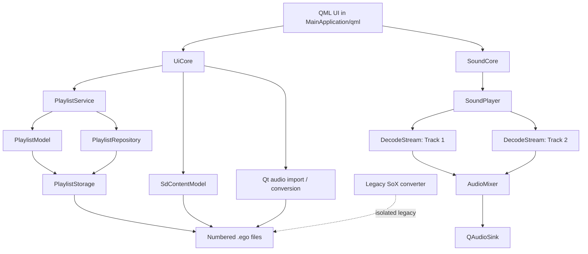

# EgoApp Architecture

*Working overview; verify against the current implementation.*

This is a conceptual diagram, not a complete call graph.

## Source layout
- MainApplication/qml/: QML presentation files compiled into the EgoApp module.
- MainApplication/: C++ entry point, application bridge objects, and media model.
- MainApplication/audio/: audio playback module (SoundCore, SoundPlayer, DecodeStream, and AudioMixer).
- MainApplication/playlists/: playlist feature module (PlaylistService, PlaylistModel, PlaylistRepository, PlaylistStorage, and Song). QML-facing type names and the .ego file format remain unchanged.
- MainApplication/icons/, translations/, and docs/: runtime resources; their resource paths remain unchanged.

## QML module and runtime loading
CMake registers QML sources from MainApplication/qml/ and assigns each source its basename through QT_RESOURCE_ALIAS. This preserves public QML type names and the AppGlobals singleton. The MainApplication/playlists/ and MainApplication/audio/ directories are added to the application target's private include paths because Qt's generated QML type-registration source includes registered C++ headers by basename. Runtime loading remains QQmlApplicationEngine::loadFromModule("EgoApp", "Main"); the application does not load QML from a source-tree filesystem path.

## Responsibility areas
- QML: presentation and lightweight coordination.
- UiCore: QML-facing application facade; owns UI state and translates application results into Qt signals. Its constructor only establishes internal signal connections. The root QML component calls `initialize()` from `Component.onCompleted`; only then does UiCore configure the initial workspace, load playlists, and configure the application language. After the workspace and playlist models are ready, UiCore emits `workspaceChanged()` to notify QML bindings to `workspacePath` and `avaliablePlaylists`. Playlist load diagnostics are delivered directly by signal because QML connections are ready before initialization starts. UiCore does not retain workspace-directory state: the workspace path is passed to SdContentModel and PlaylistService, while PlaylistService is the authoritative source for the active workspace path. UiCore does not own playlist discovery or directory lifecycle logic.
- PlaylistService: coordinates playlist discovery, creation/removal, model construction, and model lifetimes for the active workspace. It also validates an individual playlist by its stable relative path, loading song records through PlaylistRepository/PlaylistStorage and resolving media paths against its workspace root; validation does not inspect PlaylistModel roles or indexes. It is independent of QML and exposes the playlist models to UiCore.
- PlaylistRepository: recursively discovers playlist directories and safely creates/removes slash-separated relative paths under PLAYLIST/. It returns plain PlaylistData records and has no QML or Qt item-model dependency.
- PlaylistStorage: reads and writes numbered .ego files and preserves their existing two-line format (including the optional > marker). The .ego format is immutable for this work.
- PlaylistModel: one playlist’s song state and Qt Model/View contracts. It delegates persistence to PlaylistStorage and does not implement file-format parsing or filesystem discovery. It receives the workspace root explicitly so media links resolve correctly regardless of playlist nesting depth. It also exposes a structural `corrupted` state derived only from `.ego` load, filename, and numbering errors; missing WAV/media files do not set this state. Corrupted playlists are read-only at every model mutation entry point and cannot be played; QML warns on selection and visually dims the selector entry and editor controls.
- SdContentModel: selected media/folder contents.
- Audio module (MainApplication/audio/): SoundCore is the QML-facing playback facade; it validates playlist and SD-content playback requests, resolves media paths, persists playback settings, and exposes playback state. It depends on playlist/SD models only at the application integration boundary. SoundPlayer owns playback lifecycle, the QAudioSink, two DecodeStream instances, and AudioMixer; DecodeStream decodes one source and spools PCM to a temporary file; AudioMixer mixes PCM independently of the physical output device.
- SoundCore: validates playlist playback requests and resolves stored media paths through the PlaylistModel's workspace-rooted resolver; it rejects corrupted playlists and missing/non-file tracks and exposes playback state to QML. SoundPlayer: coordinates decoder streams, the audio mixer, and QAudioSink state transitions. DecodeStream: decodes one source file, owns its source and temporary PCM spool, and reports data arrival, successful completion, duration, and errors. Each decoder instance is scoped to one playback session; closing invalidates the session before stopping and retiring the decoder so late signals cannot affect a subsequent source. PCM spool growth is capped at one hour per track (44.1 kHz, stereo, signed 16-bit; about 606 MiB). Decoder errors terminate the stream as failures and are not reported as successful completion. Its spool access is mutex-protected because decoder writes and audio-output reads may occur on different threads. AudioMixer: reads and mixes PCM from zero, one, or two streams, applies channel/volume/mute settings, and reports the consumed playback position; it has no audio-device dependency.
- Qt audio conversion: primary audio-preparation path.
- SoX: isolated legacy component, not the primary audio path; do not modify third-party internals.

## PlaylistModel Qt Model/View contract
- PlaylistModel is a flat list: `rowCount(parent)` returns zero for a valid parent index.
- `moveSong(from, to)` accepts final row indexes. Internally it translates the target into Qt's `moveRows()` destination-child insertion position, which may equal the pre-move row count when moving an item to the end. `moveRows()` rejects overlapping/no-op destinations and uses Qt's required pre-removal destination-child semantics.
- Updates to one song emit `dataChanged()` with the exact affected roles: PlayNext changes only PlayNextRole; track-link changes notify the path, name, missing-state and (for track 1) MIDI-existence roles.
- `insertRows()` rejects positions outside `[0, rowCount()]` and counts that exceed the representable row range; `removeRows()` checks the requested count against the rows remaining after the starting position, avoiding overflow in `position + count`.
- Every song mutation entry point (`insertRows()`, `removeRows()`, `moveSong()`/`moveRows()`, `setLink()`, and `setPlayNext()`) rejects a corrupted playlist before preparing changes; persistence retains a final defensive guard. `setLink()` and `setPlayNext()` return success, and reject indexes belonging to another model. The unused public `refreshModel()` mutation escape hatch is removed. `moveSong()` returns whether the persistent source-model move succeeded. The QML drag proxy reverts its optimistic visual reorder on failure, and song insertion/removal changes the selection only after a successful model operation.

## Nested playlist directories
A playlist's stable identifier is its path relative to PLAYLIST/, not its basename. For example, Collections/Rock and Live/Rock are distinct playlists even though both have the display name Rock. The backend exposes every directory below PLAYLIST/ as a playlist; directories can contain both their own numbered .ego files and child directories. Existing top-level directories continue to use their existing names as identifiers.

Repository operations reject traversal and symbolic-link components and verify canonical path containment before recursively deleting a playlist directory. Removing a parent directory removes its complete nested subtree. Playlist directory nesting does not change the location, naming, content, or serialization of .ego files.

## Invariants
1. Failed operations must not destroy user source data.
2. Do not truncate an existing .ego file before its replacement is ready; writes use QSaveFile.
3. Propagate file errors and do not report stale-file cleanup failure as success.
4. Keep model data and signals consistent.
5. Keep complex file operations and playlist validation out of QML and Qt item models.
6. Make async-object and temporary-file lifetimes explicit. Decoder starvation while a source is still decoding is not end-of-stream; output starts or resumes when decoded data arrives and playback finishes only after every active decoder has finished, its buffered PCM has drained, and QAudioSink has drained its output queue.
7. Keep audio mixing independent from the physical audio output so it can be tested without an audio device.
8. Never change the existing .ego format when implementing playlist features.

## File operations and recovery
Individual .ego changes use QSaveFile. PlaylistStorage compares old and proposed records and writes only files whose numbered filename or serialized content changed. Multi-file updates first copy every affected existing .ego file into a temporary directory outside PLAYLIST, then replace/create changed records and remove obsolete records. If a write or removal fails, the storage layer attempts to restore every affected file; the reported error distinguishes successful restoration from incomplete restoration and advises checking the SD card. If restoration is incomplete, the temporary backup is deliberately retained and its path is included in the error message for manual recovery. This is rollback after a detected filesystem error, not crash-atomicity: abrupt power loss or process termination during a batch can still leave an intermediate state. Single-record changes do not create a backup directory.

## Errors and tests
Test file-open/read/write/commit failures, malformed and duplicate .ego filenames, out-of-range numbers, invalid UTF-8, incomplete records, stale-file removal failures, empty playlists, numeric file ordering, model index boundaries, reorder boundaries, and cancellation. Nested repository tests should cover recursive discovery, duplicate basenames at different depths, old top-level paths, invalid traversal, symlink rejection, and nested create/remove behavior. Automated playlist tests for storage, repository, service, and Qt Model/View contracts are implemented with Qt Test in `MainApplication/tests/playlist_tests.cpp`. They cover flat parent handling, row boundaries, single-row reorder behavior, and dataChanged role lists; see the test instructions below.

## Open questions
Further UiCore extractions: workspace policy/settings, playlist validation, localization, and external application launching.

## Media path semantics in .ego
The workspace is the root of the target SD-card content. A media path stored in an .ego record is rooted at that workspace, not at the playlist directory and not at the host OS filesystem root. The current UI generates values such as `/SONGS/Artist/Track.wav`; the leading slash marks the workspace root and resolves to `<workspace>/SONGS/Artist/Track.wav`. Never pass this stored value directly to host absolute-path resolution, resolve it relative to the playlist directory, or anchor it to the application directory/current working directory. Validate path components before joining to the workspace and reject traversal such as `.` and `..` rather than silently cleaning it. A missing leading slash may be accepted for backward compatibility but still means workspace-rooted. The current media-path convention uses forward slashes. Symbolic links on the target device are not a supported scenario and do not require a separate symlink-resolution feature. This media-path contract is distinct from playlist identifiers, which are relative to `PLAYLIST/`.

The nested-playlist UI is planned as a folder tree. Users select/expand a folder and create a child playlist by entering only its name; the creation dialog should not ask users to type a slash-separated path.

## Shared media path resolution
PlaylistService validation and PlaylistModel media roles use the same `MediaPath::resolveWorkspacePath()` helper. Keep resolution behavior centralized; do not reintroduce independent path-joining implementations in either layer.

The shared media resolver treats exactly one leading forward slash as an .ego workspace-root marker, removes that marker, and joins the remaining path to the selected workspace. It never interprets the marker as the host filesystem root. Legacy paths without the marker are also resolved from the workspace root.

The common media resolver validates the stored path before joining it to the workspace: it rejects empty components, repeated or trailing separators, backslashes, colon/drive syntax, control characters, and dot/dot-dot traversal components. A single leading slash remains valid as the workspace-root marker. This is lexical containment plus explicit rejection of existing symlink components; the application does not resolve or follow symlink targets as supported media paths.

PlaylistStorage reads each small .ego record into one byte buffer, checks `QFile::error()` immediately, and only then parses its existing two-line representation. This prevents an I/O failure during an early `readLine()` from being misreported as an empty or incomplete record. An absent/empty second line remains valid; trailing third-line data remains invalid.

### .ego enumeration and concurrent changes
PlaylistStorage excludes symbolic links from the .ego file listing and verifies that the playlist directory remains present/readable after enumeration. It rechecks each listed file before opening, reports open/read errors, and compares file size and modification time before and after reading to catch common concurrent changes or replacement. `QDir::entryList()` does not return a separate enumeration status: a still-readable empty directory is treated as a valid empty playlist, while platform-specific enumeration diagnostics are deferred. Metadata comparison is best-effort and cannot prove that no same-size rewrite with unchanged timestamp occurred.

### Playlist media validation consistency
`PlaylistService::checkPlaylist()` resolves .ego paths with the shared workspace-root resolver, rejects invalid paths, and verifies that the resolved target is an existing regular file. Device filename character validation is applied to the stored SD-card path, never to the host-specific workspace mount path. Diagnostics use the actual `Song::fileNum` .ego number. PlaylistModel missing-file roles use the same resolver and regular-file requirement; MIDI existence is reported only for an existing WAV track with a regular sibling .mid file. No file-extension restriction is added to checkPlaylist without a confirmed device-format requirement.

Media-path resolution checks each existing component beneath the workspace and rejects symbolic links rather than following them. Symlink-backed media paths are unsupported and are treated as unavailable; no symlink traversal or canonical-target feature is provided.

### Playlist playback path resolution
SoundCore must not infer the workspace root by walking upward from a playlist directory: playlist nesting depth is variable. PlaylistModel provides the shared workspace-rooted media-path resolution used by playlist validation and model roles. Before playback, SoundCore validates the model/index and rejects structurally corrupted playlists. A song may have track 1 only, track 2 only, or both; at least one path must be linked. Every non-empty path is resolved from the workspace root and must identify an existing regular file. SoundPlayer opens only linked streams, reports synchronous open failures and asynchronous decoder errors, and uses the longer decoded duration as the playback duration. Once the shorter or absent stream ends, it contributes silence while the longer stream continues.

### Playlist root loading errors
A workspace with no PLAYLIST/ directory is a valid empty workspace. If the workspace is unreadable, or an existing PLAYLIST/ path is a symlink, non-directory, or unreadable, PlaylistRepository returns an explicit load error that PlaylistService forwards through loadIssuesFound. The repository checks the root again after traversal and discards the loaded snapshot if the root disappeared or became unreadable. It does not attempt platform-specific diagnosis of partial enumeration failures in nested directories.

## Playback track selection
A playlist song may link track 1 only, track 2 only, or both. At least one track must be linked. SoundCore resolves and validates every non-empty path against the workspace root and rejects a song with no linked tracks. SoundPlayer opens only linked streams, reports an open failure to SoundCore, and uses the longer decoded duration as the playback duration. Once the shorter or absent stream ends, it contributes silence while the longer stream continues. Track 2 is not conditional on track 1.

## Playlist QML safety
All song-editing controls require an active playlist and a valid selected row. The Play next role binding returns an unchecked state when no row is selected, and a failed persistence operation restores the checkbox from the model. The playlist model intentionally supports moving one song per operation; grouped row moves are rejected.

QML registration note: classes marked with `QML_ELEMENT` and registered as creatable QML types must not be declared `final`, because Qt generates a `QQmlElement<T>` subclass for construction.